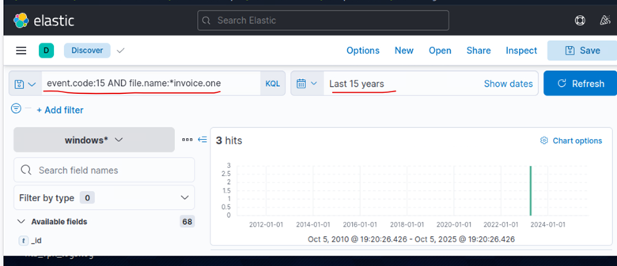
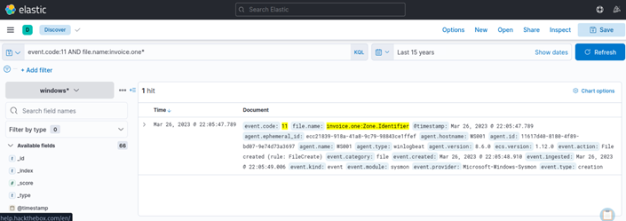
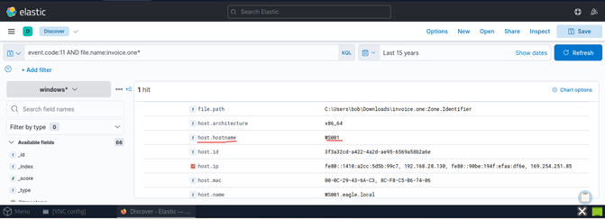

# 01 – Initial Access Investigation
Hack The Box Academy - Simulated Threat Hunting Investigation | Practice Work

## Executive Summary

This phase of the investigation focused on identifying the initial compromise vector used during the simulated **Stuxbot** intrusion.

Threat Intelligence indicated that the threat actor commonly leveraged malicious Microsoft OneNote documents to gain initial access. The primary objective of this investigation was to determine whether this technique had been observed within the monitored environment, identify the affected endpoint, establish the initial attack timeline, and collect evidence supporting the continuation of the investigation.

Analysis of Sysmon and Windows telemetry identified file creation and Alternate Data Stream (ADS) telemetry associated with a suspicious OneNote document named **invoice.one**. These findings, together with the provided Threat Intelligence, supported treating the document as a suspected initial access artifact, pending confirmation through execution and network evidence. 

The evidence collected during this phase established the foundation for the remaining stages of the investigation.

---

# Investigation Scope

This phase focuses exclusively on identifying the initial infection vector and the compromised endpoint.

Activities related to process execution, persistence, command-and-control communications, credential access, and attacker reconnaissance are documented in the subsequent sections of this repository.

---

# Investigation Objectives

The objectives of this phase were to:

- Identify the suspected malicious document.
- Determine whether the file was successfully created on the endpoint.
- Identify the affected workstation.
- Establish the initial compromise timeline.
- Collect evidence supporting continued investigation.
- Correlate findings with available Threat Intelligence.

---

# Threat Intelligence Background

According to the provided Threat Intelligence report, the Stuxbot threat actor distributes malicious payloads through phishing campaigns that leverage Microsoft OneNote documents.

The expected attack chain is illustrated below:

```text
Phishing Email
        │
        ▼
Malicious OneNote Document
        │
        ▼
Embedded Payload
        │
        ▼
Script Execution
        │
        ▼
PowerShell Activity
        │
        ▼
Payload Download
        │
        ▼
Command and Control
```

Because this attack technique was explicitly documented within the Threat Intelligence report, OneNote artifacts matching the reported attack characteristics were prioritized for investigation.

---

# Data Sources

The investigation relied on multiple telemetry sources.

## Sysmon

Sysmon telemetry was used to investigate:

- File creation events
- Process creation events
- Network connections
- DNS activity

Relevant Event IDs included:

| Event ID | Description |
|----------|-------------|
| 1 | Process Creation |
| 3 | Network Connection |
| 11 | File Creation |
| 15 | FileCreateStreamHash (Alternate Data Streams) |
| 22 | DNS Query |

---

## Windows Event Logs

Windows Event Logs were used to provide additional host and user activity context throughout the investigation.

---

## Elastic Stack

Elastic served as the primary investigation platform for:

- Query execution
- Event correlation
- Timeline reconstruction
- IOC hunting

---

# Initial IOC Discovery

The first suspicious artifact identified during the investigation was a Microsoft OneNote document named:

**invoice.one**

Because the Threat Intelligence report specifically referenced malicious OneNote attachments, this file immediately became the primary investigative artifact.

The investigation therefore began by searching for Alternate Data Stream activity associated with the document.

---

# Event ID 15 Investigation

## Detection Query - Alternate Data Stream Activity

```text
event.code:15 AND file.name:*invoice.one
```

## Investigation Rationale

Sysmon Event ID 15 (**FileCreateStreamHash**) records creation of Alternate Data Streams (ADS) and associated file stream metadata. 

Threat actors can abuse ADS to conceal malicious content within otherwise legitimate files.

Example:

```text
invoice.one

↓

invoice.one:hiddenpayload
```

While the user only observes:

```text
invoice.one
```

the hidden stream may contain malicious content invisible during normal usage.

However, the presence of an ADS event alone does not establish malicious activity. The specific stream name, originating process and surrounding events must be examined before determining whether the activity represents suspicious payload staging.

Because the Threat Intelligence report described advanced attacker tradecraft, ADS activity associated with a OneNote document represented an investigative lead requiring further investigation.

---

## Findings

The query returned telemetry associated with **invoice.one**, confirming the presence of Alternate Data Stream activity.

Although compromise was not yet confirmed, the following observations justified continued investigation:

- ADS activity was observed on a file matching the reported attack artifact.
- The filename matched Threat Intelligence reporting.
- The event provided a timestamp for correlation with file creation and subsequent activity.

---

## Investigative Pivot 

At this stage the investigation sought to answer several questions:

- Was the file successfully created?
- Which endpoint generated the event?
- Did execution occur after creation?
- Was subsequent network activity observed?

To answer these questions, file creation telemetry was investigated next.

The ADS event established **invoice.one** as a relevant artifact for further examination. The investigation pivoted to Sysmon Event ID 11 to verify file creation and identify the associated endpoint.

---

## Evidence

**Figure 1**

Sysmon Event ID 15 showing Alternate Data Stream activity associated with **invoice.one**.




---

# Event ID 11 Investigation

## Detection Query - File Creation

```text
event.code:11 AND file.name:invoice.one*
```

## Investigation Rationale

Sysmon Event ID 11 (**FileCreate**) records file creation activity on the monitored endpoint. 

Whereas Event ID 15 identified file stream activity, Event ID 11 confirmed that the suspicious document had been created on the endpoint.

---

## Findings

Telemetry confirmed creation of:

**invoice.one**

The event also contained valuable investigative context including:

- Timestamp
- Hostname
- File path
- Process information

---

## Timeline Significance

The observed sequence included the following events:

```text
File Created
        │
        ▼
Alternate Data Stream Activity
```
The relationship and chronological order of these events should be established using their recorded timestamps. Together, they supported further investigation of the document as a potential initial access artifact.

---

## Investigative Assessment

The combination of:

- Sysmon Event ID 11
- Sysmon Event ID 15

provided correlated file-system evidence associated with **invoice.one**. While these events did not independently confirm malicious execution, they strengthened the basis for further investigation when considered alongside the Threat Intelligence report.

At this stage, the file became the primary investigative pivot for all subsequent analysis.

---

## Evidence

**Figure 2**

Sysmon Event ID 11 confirming creation of **invoice.one**.



---

# Host Identification

The next objective was identifying the workstation responsible for generating the observed telemetry.

Analysis of the Event ID 11 results identified:

**WS001**

---

## Evidence

**Figure 3 – Host Identification**

Host metadata identifying the workstation under investigation, **WS001** associated with the suspicious file **invoice.one**.



---

## Investigation Significance 

Identifying the affected endpoint enabled:

- Targeted investigation
- Reduced investigative scope
- Correlation with network telemetry
- Correlation with Zeek logs

---

# Network Connection Investigation

## Detection Query - Endpoint Network Connections

```text
event.code:3 AND host.hostname:WS001
```

## Investigation Rationale

Sysmon Event ID 3 records network connection activity and provides:

- Source IP
- Destination IP
- Destination Port
- Associated Process

---

## Findings

The workstation under investigation was identified as:

**WS001**

with source IP:

**192.168.28.130**

This address became the primary pivot point for the network investigation documented in the following phase.

---

## Evidence

**Figure 4**

Sysmon Event ID 3 identifying network activity originating from the workstation **WS001**, and confirming source IP **192.168.28.130**.


---

# Initial Timeline Reconstruction

The investigation reconstructed the following sequence:

```text
invoice.one Downloaded
        │
        ▼
File Created
        │
        ▼
Alternate Data Stream Activity
        │
        ▼
Compromised Host Identified
        │
        ▼
Network Investigation Initiated
```

---

# MITRE ATT&CK Mapping

| Tactic | Technique |
|---------|-----------|
| Initial Access | T1204 – User Execution (requires corroborating process execution evidence)|
| Defense Evasion | T1564.004 – Hide Artifacts: NTFS File Attributes (requires confirmation of deliberate ADS abuse) |

These techniques were identified as relevant to the suspected attack chain. Their applicability should be validated against process execution evidence and ADS stream metadata in the subsequent investigation phases. 

---

# Detection Opportunities

This investigation identified several detection opportunities for SOC teams:

- Monitor external downloads of **.one** files.
- Monitor suspicious Sysmon Event ID 15 activity, correlating ADS stream names, file paths, and associated processes to reduce false positives.
- Detect **ONENOTE.EXE** spawning child processes such as **cmd.exe** or **powershell.exe**.
- Monitor suspicious file creation within user download locations.
- Correlate Sysmon Event IDs 11 and 15 to identify potentially suspicious file and ADS activity. 

---

# Key Findings

This phase successfully established that:

- Suspicious OneNote document **invoice.one** was identified.
- Alternate Data Stream activity was confirmed.
- File creation was verified.
- The affected endpoint (**WS001**) was identified.
- Source IP **192.168.28.130** was confirmed.
- Correlation of file creation, ADS activity, and endpoint telemetry established the basis for further investigation into execution, persistence, command-and-control communications, and credential access.
