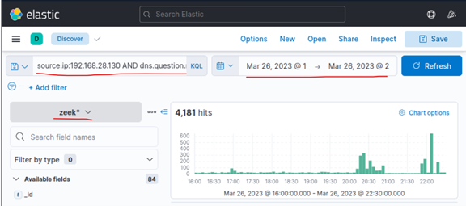
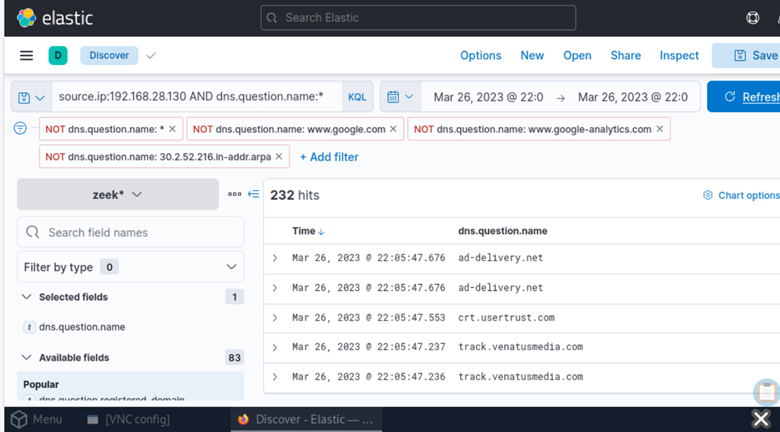
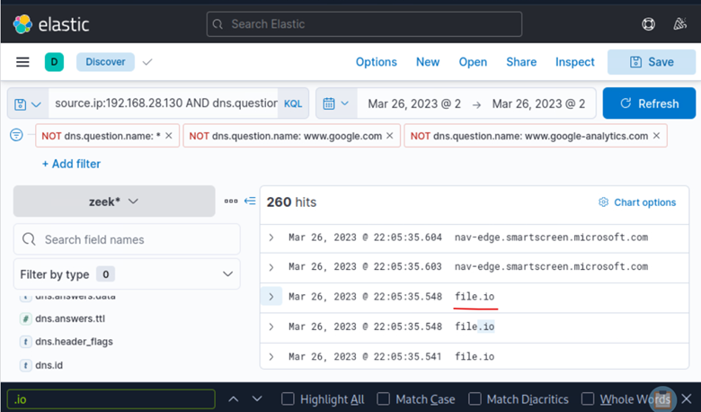
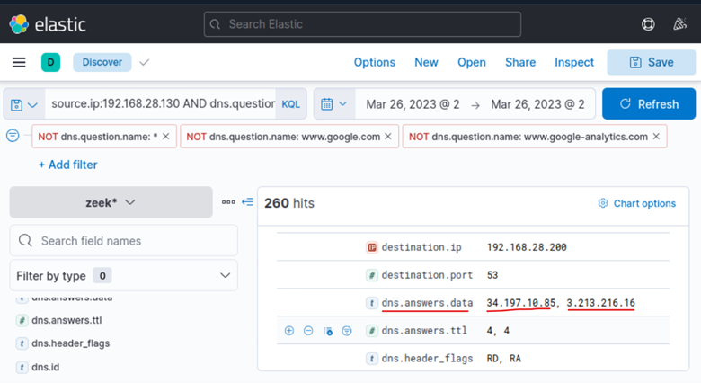
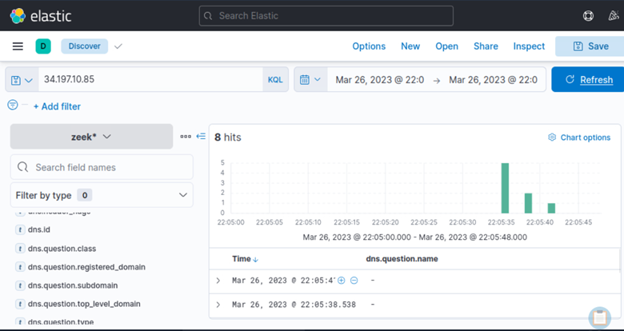

# 02 – Network Investigation

## Executive Summary 

Following confirmation that the malicious OneNote document **invoice.one** had been created on workstation **WS001**, the investigation shifted toward network telemetry to determine how the payload entered the environment and whether the compromised host established communications with infrastructure.
The primary objectives of this phase were:

  •	Identify external infrastructure contacted by the infected host.
  •	Determine the source of the malicious document.
  •	Validate whether download activity occurred.
  •	Identify command-and-control communications.
  •	Correlate DNS activity with network connections.
  •	Reconstruct attacker communications.
  
Analysis of Zeek DNS logs, Zeek connection logs, and Sysmon network events enabled reconstruction of the network component of the intrusion. The investigation identified multiple suspicious domains, including **file.io**, **pastebin.com**, and **ngrok.io**, revealing evidence of payload delivery, command retrieval, and command-and-control communications. 
The findings established that the compromised workstation downloaded malicious content from external infrastructure and maintained communication with attacker-controlled services.

# Investigation Objectives 

The objectives of this phase were:
•	Identify network activity originating from WS001.
•	Identify suspicious DNS queries.
•	Determine the source of invoice.one.
•	Verify network connections following DNS resolution.
•	Identify command-and-control infrastructure.
•	Correlate host telemetry with network telemetry.

# Starting Point 

The previous phase identified:
Host:
WS001

Source IP:
192.168.28.130
This IP became the pivot point for the remainder of the network investigation.
 
# Data Sources Used

| Data Source | Purpose |
|-------------|---------|
| Zeek DNS Logs | Domain lookups, DNS responses and resolved IP addresses |
| Zeek Connection Logs | Network connections, destination IPs, ports and communication patterns |
| Sysmon Event ID 3 | Process-specific network activity and process attribution |

# DNS Investigation 

The investigation began by examining DNS requests originating from the affected host.
Query:
source.ip:192.168.28.130 AND dns.question.name:*

# Why DNS Matters 

DNS acts as the "phone book" of the internet.
Before a system can communicate with:
file.io
it must first determine:
Which IP address belongs to file.io?
This process generates DNS logs.
DNS telemetry frequently provides the earliest evidence of attacker communications.

## Initial Findings 

The query returned over two hundred DNS events.
Many were expected:
•	Microsoft services
•	Google services
•	Browser telemetry
•	Update mechanisms
These events represented normal background activity.

# Noise Reduction 

To isolate suspicious domains, common entries were excluded.
Examples:
NOT dns.question.name:www.google.com
NOT dns.question.name:www.google-analytics.com
NOT dns.question.name:30.2.52.216.in-addr.arpa

# Why Noise Reduction Is Important 

Without filtering:
Legitimate Traffic
>>>>>>>>>>>>>
Malicious Traffic
The signal becomes difficult to identify.
Threat hunters frequently reduce noise before identifying anomalies.

## Evidence

**Figure 1 – Raw DNS activity generated by WS001**

The initial DNS investigation shows all DNS requests generated by the compromised workstation **WS001** before any filtering was applied. This provided the baseline dataset used for subsequent threat hunting activities.

# Discovery of file.io 

After filtering, a suspicious domain appeared:
file.io

The appearance of **file.io** immediately after execution of the malicious OneNote document significantly increased confidence that the service had been used as the initial malware delivery mechanism.
 
# Why file.io Is Interesting 

file.io is a legitimate file-hosting service.
However, it is frequently abused by attackers because:
•	Files can be uploaded anonymously.
•	Links can expire automatically.
•	Hosting is free.
•	Payload delivery is simple.
 
## Threat Hunting Assessment 

When file.io appears immediately before:
File Creation
+
Execution Activity
the probability of malicious behavior increases significantly.
 
## Evidence

**Figure 2 – DNS results after filtering common benign domains**

Filtering removed common background DNS traffic, allowing suspicious domains to be identified more efficiently during the investigation.

# DNS Resolution Analysis 

Inspection of the DNS event revealed:
34.197.10.85
3.213.216.16
These addresses were returned by DNS.
This means:
WS001
    ↓
Asked for file.io
    ↓
DNS returned:
34.197.10.85
3.213.216.16

# Why DNS Resolution Alone Is Not Enough 

A DNS query does not prove communication occurred.
Example:
User types website
        ↓
DNS lookup occurs
        ↓
Connection never happens
Therefore the next step was verifying network connections.

# Connection Verification 

The investigation pivoted into connection logs.
Objective:
Determine whether WS001 actually communicated with the returned IP addresses.
 
# Investigation Logic 

Required chain:
DNS Query
      ↓
DNS Response
      ↓
Network Connection
      ↓
File Creation
Only when all four exist can download activity be confidently established.
 
## Findings 

Network telemetry confirmed connections to the file.io infrastructure.
This provided strong evidence that:
invoice.one
originated from the identified external service.

## Evidence

**Figure 3 – Discovery of file.io DNS requests**

DNS telemetry identified repeated queries for **file.io**, indicating potential malware staging or payload delivery activity.

## Timeline Reconstruction

Correlation between:
•	DNS activity
•	Connection activity
•	File creation
revealed a consistent timeline.
DNS Query
      ↓
Connection
      ↓
invoice.one Created
The timing strongly supported download activity.

# Discovery of Pastebin

Further analysis identified references to:
pastebin.com

Unlike file.io, which appeared to be used for payload delivery, Pastebin was associated with retrieval of PowerShell instructions executed during the next phase of the intrusion. 

# Why Pastebin Matters 

Pastebin is frequently abused by attackers to:
•	Host PowerShell payloads
•	Store encoded commands
•	Deliver second-stage malware
It is commonly used because it appears legitimate.

## Threat Hunting Assessment 

Pastebin activity immediately after:
invoice.one
execution significantly increased confidence that the host had been compromised.

## Evidence

**Figure 4 – DNS resolution for file.io**

DNS responses resolved **file.io** to the external IP addresses **34.197.10.85** and **3.213.216.16**, providing infrastructure used later for connection verification.

 
# Discovery of ngrok 

The most significant finding involved:
ngrok.io

Repeated communications over multiple days distinguished ngrok activity from one-time payload delivery and suggested the presence of persistent command-and-control communications.
 
# What Is ngrok? 

Ngrok is a legitimate tunneling service.
It allows:
Internal Host
      ↓
Encrypted Tunnel
      ↓
Public Internet
Attackers frequently abuse ngrok because:
•	Infrastructure changes rapidly.
•	HTTPS traffic appears normal.
•	Traditional blocking is difficult.

# DNS Investigation of ngrok 

Query:
ngrok.io
revealed multiple DNS resolutions.
Returned infrastructure included:
18.158.249.75

3.125.102.39

## Evidence

**Figure 5 – Network connections to resolved file.io infrastructure**

Network telemetry confirmed successful communication between the compromised workstation and the infrastructure associated with **file.io**, validating payload delivery.

## Command and Control Assessment 

The investigation observed:
•	Repeated DNS requests
•	Repeated HTTPS connections
•	Activity spanning multiple days
These observations are consistent with:
Command and Control (C2)
behavior.

# Why Persistence Was Suspected 

The attacker infrastructure continued to appear:
Day 1
↓
Day 2
↓
Additional Connections
This suggested:
•	Malware survived execution
•	Automated callbacks existed
•	Attacker communications remained active

### Assessment 

Although repeated communications with the identified infrastructure were observed during the investigation, the primary objective of this phase was to identify and validate the external infrastructure used throughout the intrusion.

The collected DNS telemetry, resolved IP addresses, and verified network connections provided sufficient evidence to conclude that the compromised workstation successfully communicated with attacker-controlled infrastructure consistent with command-and-control (C2) behaviour.

## MITRE ATT&CK Mapping 

| Tactic | Technique |
|---------|-----------|
| Command and Control | T1071 – Application Layer Protocol |
| Command and Control | T1572 – Protocol Tunneling |
| Command and Control | T1105 – Ingress Tool Transfer |

## Detection Opportunities 

Organizations should monitor:
| Indicator | Detection Opportunity |
|-----------|----------------------|
| file.io | Monitor unexpected access to anonymous file-sharing services |
| Pastebin | Detect PowerShell retrieving remote content |
| ngrok | Monitor tunneling services within enterprise environments |
| Repeated HTTPS callbacks | Identify long-term communications with rare external infrastructure |

## Key Findings 

- DNS telemetry identified suspicious external infrastructure.
- file.io was identified as the malware delivery platform.
- Network connections confirmed successful payload retrieval.
- Pastebin hosted additional PowerShell content.
- ngrok infrastructure was repeatedly contacted.
- Command-and-control communications were established. 

## Lessons Learned 

1.	DNS telemetry frequently provides the earliest evidence of compromise.
2.	File-sharing platforms remain common malware delivery mechanisms.
3.	Network telemetry is essential for validating download activity.
4.	Tunneling platforms such as ngrok should be monitored closely.
5.	Long-term communication patterns often reveal persistence.

## Conclusion 

Network investigation confirmed that the compromised workstation communicated with attacker-controlled infrastructure and downloaded malicious content.
DNS telemetry identified file.io, pastebin.com, and ngrok.io as key components of the attack chain. Connection logs verified communication with resolved infrastructure, while repeated activity across multiple days strongly suggested active command-and-control communications.
These findings established the external infrastructure supporting the intrusion and provided the foundation for analyzing process execution, PowerShell activity, persistence mechanisms, and credential access attempts in the next phase of the investigation. 
