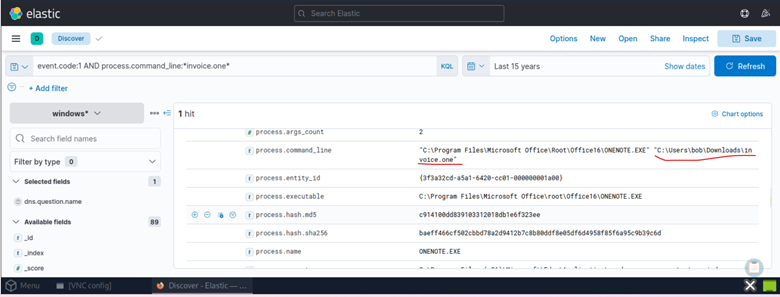
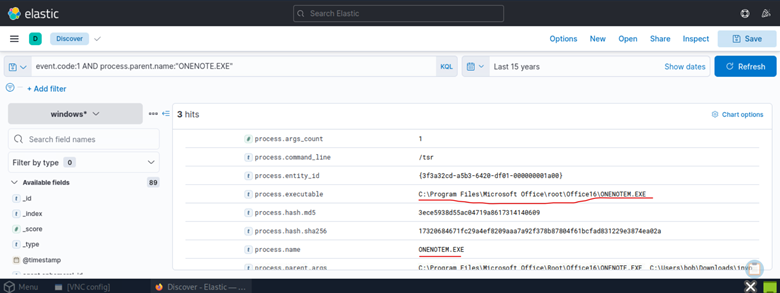
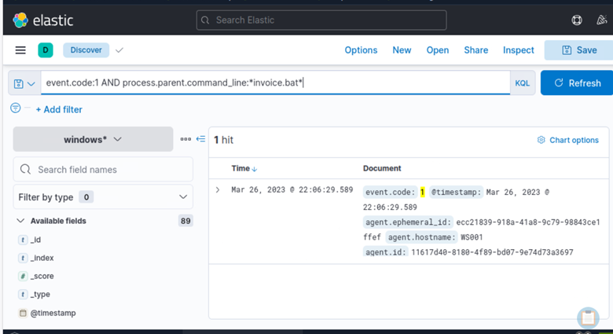

# Phase 1 – Initial Execution

## Objective

The first objective of this phase was to determine exactly what occurred immediately after the victim opened the malicious **invoice.one** document. Understanding the initial execution chain provides the foundation for reconstructing the remainder of the intrusion and identifying the techniques used by the attacker.

---

## Investigating OneNote Execution

### Query

```text
event.code:1 AND process.command_line:*invoice.one*
```

### Investigation Methodology 

Sysmon Event ID **1** (Process Creation) telemetry was examined in Elastic to identify processes associated with the execution of the suspicious OneNote document. The query filtered process commnad-line activity referencing **invoice.one**, allowing the initial execution event to be identified and correlated with subsequent process activity. 

---

### Findings

The investigation identified Microsoft OneNote (**ONENOTE.EXE**) opening the malicious document located at:

```text
C:\Users\bob\Downloads\invoice.one
```

Timeline correlation with previous investigation phases showed that the document was downloaded, created on disk, and opened within only a few seconds.

Observed sequence:

```text
File Download
        ↓
File Creation
        ↓
User Opens invoice.one
```
The short interval between file creation and document execution established a relevant timeline for investigating potential malicious activity. Subsequent process creation events were examined to determine whether the document initiated suspicious execution.

---

## Evidence

**Figure 1 – Microsoft OneNote opening the malicious document `invoice.one`.**

The process creation event confirms that **ONENOTE.EXE** executed the downloaded document, marking the beginning of the execution phase.



---

## Child Process Investigation

### Query

```text
event.code:1 AND process.parent.name:"ONENOTE.EXE"
```

### Process Lineage Analysis 

Process creation telemetry was filtered by the parent process **ONENOTE.EXE** to identify child processes and investigate potential execution of embedded content.

Unexpected child processes often indicate exploitation or execution of embedded content.

---

### Findings

Three child processes were identified.

One process occurred outside the relevant investigation timeline and was excluded from further analysis.

The remaining execution chain revealed:

- OneNoteM.exe
- cmd.exe

---

## Understanding OneNoteM.exe

**OneNoteM.exe** is a legitimate Microsoft component commonly responsible for assisting OneNote when opening embedded content, attachments, or linked objects.

Although legitimate, its appearance immediately before execution of malicious processes helps reconstruct the complete execution chain.

Observed sequence:

```text
ONENOTE.EXE
        ↓
OneNoteM.exe
        ↓
Malicious Activity

The presence of OneNoteM.exe was treated as contextual process evidence rather than an independent indicator of compromise. 

```

---

## Evidence

**Figure 2 – Child Process Activity Associated with Microsoft OneNote.**

Sysmon event ID 1 identified three process creation events with **ONENOTE.EXE** as the parent process. These events were examined to investigate child process activity and reconstruct the execution chain following the opening of **invoice.one**.



---

## Discovery of cmd.exe

The most significant child process identified during the investigation was **cmd.exe**.

Analysis of the process command line revealed execution of:

```text
invoice.bat
```

---

### Suspicious Execution Behaviour 

Microsoft OneNote documents do not normally launch the Windows command interpreter or execute batch scripts.

Execution of **cmd.exe** immediately after opening the document strongly indicates that embedded malicious content successfully initiated the next stage of the attack.

The reconstructed execution chain now became:

```text
invoice.one
        ↓
ONENOTE.EXE
        ↓
cmd.exe
        ↓
invoice.bat

This behaviour was identified as a suspicious deviation from expected document-handling activity and provided evidence of command execution associated with the OneNote document.

```

---

## Evidence

**Figure 3 – Process Creation Activity Associated with invoice.bat.**

Sysmon Event ID 1 identified a process creation event on workstation **WS001** at **22:06:29:589**, where this parent process command line referenced **invoice.bat**. This event provided a correlation point for investigating subsequent process execution within the suspected attack chain.



---

## Phase 1 Summary

The initial execution phase confirmed that the malicious OneNote document successfully triggered a sequence of child processes immediately after being opened by the victim.

The investigation established the first stages of the attack chain:

```text
invoice.one
        ↓
ONENOTE.EXE
        ↓
OneNoteM.exe
        ↓
cmd.exe
        ↓
invoice.bat
```

This execution chain provided the foundation for the subsequent payload delivery phase, where the attacker leveraged **PowerShell** to retrieve and execute additional malicious content.
