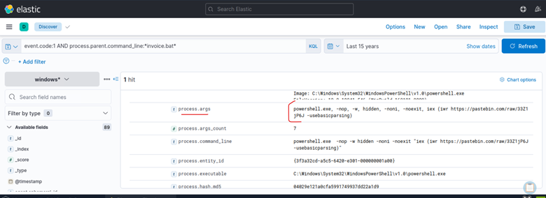
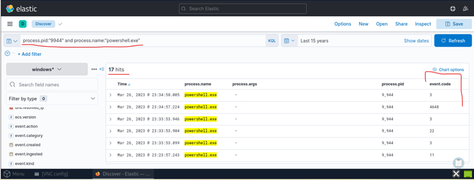

# Phase 2 – Payload Delivery

## Objective

Following confirmation that the malicious OneNote document successfully executed a batch script, the next objective was determining how the attacker delivered the primary payload to the compromised host.

This phase focuses on reconstructing the PowerShell activity responsible for downloading and executing additional malicious content while minimizing forensic artifacts on disk.

---

## Investigating invoice.bat

### Query

```text
event.code:1 AND process.parent.command_line:*invoice.bat*
```

### Investigation Methodology

Sysmon Event ID (Process Creation) telemetry was filtered using the parent process command line referencing **invoice.bat** to identified processes launched during batch script execution.

Tracing parent-child process relationships allows investigators to reconstruct the complete execution chain and understand how the attacker transitioned from initial execution to payload delivery.

---

### Findings

The investigation identified a single significant child process:

```text
powershell.exe
```

The execution chain now expanded to:

```text
invoice.one
        ↓
ONENOTE.EXE
        ↓
cmd.exe
        ↓
invoice.bat
        ↓
powershell.exe
```

The execution of PowerShell through the batch script was identified as suspicious process behaviour. Subsequent command-line analysis established that PowerShell was being used to retrieve remote content, consistent with the use of legitimate Windows utilities for malicious execution. 

---

## PowerShell Execution Analysis

PowerShell is a legitimate Windows administration utility capable of retrieving remote resources and executing commands. In this investigation, its execution through **invoice.bat** warranted further examination of the process arguments, command-line activity and associated network connections to determine the payload delivery mechanism.

---

## Evidence

**Figure 4 – PowerShell launched by 'invoice.bat'.**

Process creation telemetry confirms that **invoice.bat** initiated **powershell.exe**, transitioning the intrusion from initial execution into payload delivery.




---

## Investigating PowerShell Activity

Analysis of the PowerShell command line revealed the following external resource:

```text
https://pastebin.com/raw/33Z1jP6J
```

---

## Identification of Remote Payload Infrastructure 

The identified URL pointed to a raw Pastebin resource referenced in the PowerShell command line. Although Pastebin is a legitimate text-sharing platform, its use within the suspicious execution chain indicated that it was functioning as a remote payload staging location.

The URL was retained as an investigation artifact for correlation with PowerShell execution telemetry and associated network activity.

---

## Remote Payload Retrieval and Execution

Command-line analysis identified the use of **Invoke-WebRequest (iwr)** and **Invoke-Expression (iex)**. These commands were used together to retrieve content from the external Pastebin resource and execute the retrieved instructions through PowerShell. 

---

## Execution Mechanism

Rather than containing the complete payload within the original OneNote document, the execution chain referenced externally hosted content retrieved during runtime. 

The execution flow becomes:

```text
Remote Payload
        ↓
PowerShell Download
        ↓
Memory Execution
```

This execution method can reduce the need to write payload files to disk and may complicate file-based detection. The combination of remote content retrieval and immediate execution was treated as a significant indicator of malicious PowerShell activity. 

---

## Evidence

**Figure 5 – PowerShell retrieving and executing a remote payload from Pastebin using 'Invoke-Expression (iex)' and 'Invoke-WebRequest (iwr)'.**

The command line confirms that PowerShell downloaded additional attacker-controlled content directly from Pastebin.

The observed command structure also indicates that the retrieved content was intended for execution through PowerShell.


---

## Tracking PowerShell Activity

### Query

```text
process.pid:"9944" AND process.name:"powershell.exe"
```

### Process-Specific Timeline Analysis

The investigation filtered Elastic telemetry using **PID 9944** and the process name **powershell.exe** to isolate events associated with the identified PowerShell instance.

Tracking a single process instance allows investigators to reconstruct the recorded activity associated with that process during the available investigation window.

---

### Telemetry Fields Examined

| Field | Purpose |
|--------|---------|
| event.code | Identify the type of recorded activity |
| file.path | Determine files created or modified |
| destination.ip | Identify outbound communications |
| dns.question.name | Review DNS lookups performed by PowerShell |
| process.args | Inspect executed PowerShell arguments |

---

### Timeline Analysis

The process-specific investigation focused on correlating available telemetry related to:

- Files created by PowerShell
- Domains queried
- Remote infrastructure contacted
- Additional payload execution
- Network communication associated with the malicious process

Correlating these events helped reconstruct the observable activity of the PowerShell process and identify potential indicators of compromise associated with payload delivery.

---

## Evidence

**Figure 6 – Timeline of malicious PowerShell activity showing multiple Sysmon events associated with the same PowerShell process (PID 9944).**

Process-specific telemetry provides a consolidated view of recorded events associated with the identified PowerShell instance, supporting timeline reconstruction and further investigation of subsequent activity.



---

## Detection Opportunities

| Activity | Detection Opportunity |
|----------|-----------------------|
| invoice.bat spawning PowerShell | Monitor PowerShell execution originating from batch scripts |
| PowerShell retrieving Pastebin content | Detect outbound connections to Pastebin initiated by PowerShell |
| PowerShell downloading remote scripts | Alert on DownloadString(), Invoke-WebRequest and similar techniques |
| PowerShell network activity | Correlate PowerShell process creation with DNS and outbound connections |

These detection opportunities were derived from the observed execution chain and provide potential starting points for identifying similar activity through endpoint and network telemetry.

---

## Phase 2 Summary

The payload delivery phase confirmed that the attacker leveraged **PowerShell** to retrieve additional malicious content from external infrastructure immediately after execution of **invoice.bat**.

The reconstructed execution chain expanded to:

```text
invoice.one
        ↓
ONENOTE.EXE
        ↓
cmd.exe
        ↓
invoice.bat
        ↓
powershell.exe
        ↓
Pastebin Payload
```

The investigation identified a PowerShell-based payload retrieval and execution mechanism involving externally hosted on Pastebin. The observed use of **Invoke-WebRequest** and **Invoke-Expression** was consistent with in-memory execution techniques establishing a link between initial document execution and subsequent post-exploitation activity. 
