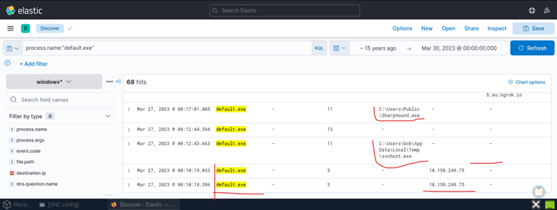
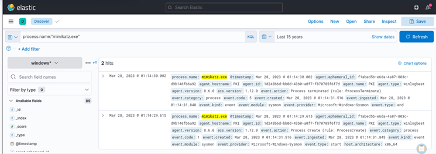
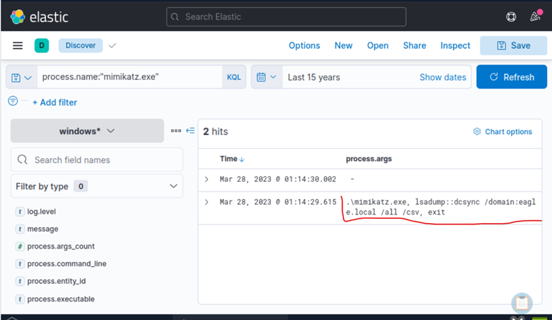

# 04 - Credential-Access Investigation

## Executive Summary

Following the successful execution of malicious payloads and the establishment of command-and-control communications, the investigation shifted toward determining whether the attacker attempted to obtain credentials from the Active Directory environment.
Analysis of Sysmon telemetry identified the deployment and execution of two well-known offensive security tools: SharpHound and Mimikatz. Their presence indicates that the attacker had progressed beyond initial compromise and was actively targeting the Active Directory environment. SharpHound was used to enumerate Active Directory objects and identify privilege escalation paths, while Mimikatz was executed with arguments indicating an attempted DCSync attack against the domain.
This phase of the investigation demonstrates that the attacker progressed beyond initial compromise and post-exploitation activities into credential theft operations, significantly increasing the potential impact of the intrusion.

# Investigation Objectives

The objectives of this investigation phase were:
•	Determine whether attacker activity involved credential theft.
•	Identify credential access tooling used during the intrusion.
•	Analyze execution of SharpHound and Mimikatz.
•	Determine whether Active Directory was targeted.
•	Identify evidence of DCSync activity.
•	Assess the likelihood of domain compromise.
•	Document attacker objectives and impact.

# Previous Investigation Findings

Earlier stages of the investigation established the following attack chain:

invoice.one
      ↓
ONENOTE.EXE
      ↓
cmd.exe
      ↓
invoice.bat
      ↓
powershell.exe
      ↓
Pastebin Payload
      ↓
default.exe
      ↓
Ngrok C2

At this stage, the attacker had already established execution, persistence, and command-and-control communications. The next objective was to determine whether post-exploitation activity had progressed into Active Directory credential access.
During analysis of the default.exe activity, several additional files were identified:

SharpHound.exe
svchost.exe
payload.exe
XceGuhkzaTr0y.vbs

The appearance of SharpHound immediately raised concerns regarding Active Directory reconnaissance.

# Discovery of SharpHound

Why SharpHound Matters

SharpHound is the data collection component of the BloodHound framework.
Its purpose is not credential theft directly.
Instead, it performs reconnaissance against Active Directory environments.

SharpHound collects:
•	Domain Users
•	Domain Groups
•	Active Sessions
•	Trust Relationships
•	Local Administrators
•	ACL Permissions
•	Delegation Settings

This information is later imported into BloodHound for attack path analysis.

# Attacker Workflow

Typical attacker workflow:

Initial Compromise
       ↓
Privilege Escalation
       ↓
SharpHound Collection
       ↓
BloodHound Analysis
       ↓
Identify Attack Paths
       ↓
Target High-Value Accounts

# Evidence of SharpHound Deployment

During investigation of default.exe, the executable was observed interacting with:

SharpHound.exe

This strongly suggests the attacker was actively gathering information about the Active Directory environment.

# Screenshot Placeholder

Caption: Figure 1 – SharpHound artifact identified during default.exe investigation.

## Active Directory Reconnaissance Assessment

The deployment of SharpHound indicates that the attacker had moved beyond simple malware execution.
At this stage the attacker was attempting to answer questions such as:

Who are the Domain Admins?

Which users have local administrator rights?

Which hosts contain privileged sessions?

What attack paths exist toward Domain Admin?

This represents a significant escalation in attacker capability.
At this point, the attacker was no longer focused on the compromised workstation alone but was attempting to understand the broader Active Directory environment and identify privilege escalation opportunities.

## MITRE ATT&CK Mapping

Technique	Description
T1087	Account Discovery
T1069	Permission Group Discovery
T1018	Remote System Discovery
T1482	Domain Trust Discovery

## Discovery of Mimikatz

Following Active Directory reconnaissance, attention shifted toward identifying evidence of credential theft tooling.
The next phase focused on identifying credential theft activity.
Query used:

process.name:"mimikatz.exe"

# Why This Query Matters

Mimikatz is one of the most widely used credential access tools.
It is frequently deployed after attackers establish initial access and perform reconnaissance.
Capabilities include:
•	Credential Dumping
•	NTLM Hash Extraction
•	Kerberos Ticket Theft
•	Golden Ticket Attacks
•	Pass-the-Hash
•	DCSync
Finding Mimikatz in an environment is generally considered a high-confidence indicator of malicious activity.

# Screenshot Placeholder

Caption: Figure 2 – Mimikatz process execution identified within Sysmon logs.

## Process Argument Analysis

After identifying Mimikatz execution, the next objective was determining how it was used.
Additional column added:
process.args
This field reveals the arguments supplied to Mimikatz during execution.

# Investigation Procedure

Query:

process.name:"mimikatz.exe"

Columns:

process.name
process.args
process.command_line
@timestamp

# Why Process Arguments Matter

Attackers rarely execute Mimikatz without specific objectives.
The arguments reveal:

What functionality was used

Which credentials were targeted

Whether Active Directory was involved

Whether credential dumping occurred

## Findings

Analysis of the command-line arguments indicated that the attacker was attempting a:
DCSync Attack
rather than performing local credential dumping.
This distinction is important because DCSync targets the entire Active Directory environment rather than a single host.

# Screenshot Placeholder

Caption: Figure 3 – Mimikatz command-line arguments revealing DCSync functionality.

# Understanding DCSync

Normal Active Directory Replication
Under normal circumstances:
Domain Controller A
          ↓
Replicates
          ↓
Domain Controller B
Domain Controllers exchange password hashes and directory information.

# DCSync Abuse

In a DCSync attack:

Attacker
      ↓
Pretends To Be Domain Controller
      ↓
Requests Password Data
      ↓
Receives Password Hashes

The attacker abuses Microsoft replication functionality to retrieve credentials.

# Why DCSync Is Dangerous

Unlike traditional credential dumping:
No LSASS Dump Required

No Local Memory Extraction Required

No Interactive Login Required
Instead, the attacker can retrieve password hashes directly from Active Directory.

# Potential Targets

A successful DCSync attack may expose:

Domain Admin Accounts

Service Accounts

Privileged Users

Enterprise Admins

KRBTGT Account

Compromise of the KRBTGT account can eventually lead to Golden Ticket attacks.

## Attack Chain Progression

The attacker's progression during the intrusion appears as follows:

invoice.one
      ↓
PowerShell
      ↓
default.exe
      ↓
SharpHound
      ↓
Active Directory Enumeration
      ↓
Mimikatz
      ↓
DCSync
      ↓
Credential Theft

## Timeline Reconstruction

Timeline Summary

Phase 1 – Initial Access

Phase 2 – Execution

Phase 3 – Command and Control

Phase 4 – Active Directory Reconnaissance

Phase 5 – Credential Access

Phase 6 – DCSync Attempt

## MITRE ATT&CK Mapping

| Tactic | Technique | ID |
|--------|-----------|----|
| Credential Access | OS Credential Dumping | T1003 |
| Credential Access | DCSync | T1003.006 |
| Discovery | Account Discovery | T1087 |
| Discovery | Permission Group Discovery | T1069 |

## Threat Assessment

Several factors indicate a highly capable attacker:
Use of PowerShell
Demonstrates fileless execution techniques.
Use of Ngrok
Provides encrypted command-and-control infrastructure.
Use of SharpHound
Indicates Active Directory awareness.
Use of Mimikatz
Indicates credential theft objectives.
DCSync Functionality
Indicates an attempt to compromise the entire domain.
Overall, the observed tooling and attacker behavior are consistent with a targeted Active Directory intrusion rather than opportunistic malware execution.

## Key Findings

✓ SharpHound.exe was identified on the compromised host.
✓ SharpHound activity indicates Active Directory reconnaissance.
✓ Mimikatz.exe was executed successfully.
✓ Process arguments indicate DCSync functionality.
✓ The attacker targeted Active Directory credentials.
✓ The objective extended beyond workstation compromise.
✓ Evidence suggests attempted domain-level credential theft.

## Analyst Assessment

Based on available evidence, the attacker successfully progressed through the following stages:

Initial Access
      ↓
Execution
      ↓
Command & Control
      ↓
Reconnaissance
      ↓
Credential Access

The deployment of both SharpHound and Mimikatz demonstrates deliberate attacker behavior consistent with an Active Directory-focused intrusion.
The presence of DCSync functionality represents the highest-confidence indicator that the attacker intended to compromise privileged Active Directory accounts..

## Conclusion

The Credential Access phase of the Stuxbot investigation revealed that the attacker moved beyond simple malware execution and established a foothold within the Active Directory environment.
Evidence showed the deployment of SharpHound for reconnaissance and Mimikatz for credential theft operations. Analysis of process arguments revealed attempted DCSync activity, indicating that the attacker sought access to password hashes stored within Active Directory.
These findings significantly elevate the severity of the incident and suggest that the attacker’s objective was not limited to a single workstation, but potentially included compromise of privileged accounts and broader domain infrastructure.
No evidence was identified confirming successful domain compromise; however, the observed attacker tooling and DCSync activity indicate that the intrusion had reached a critical stage requiring immediate containment and credential rotation.
